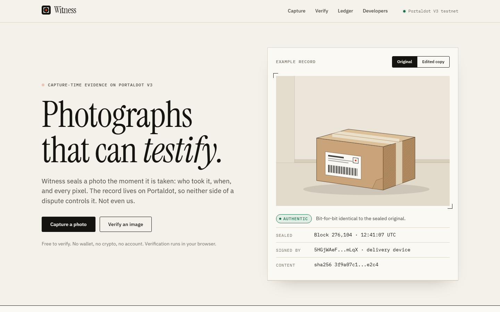
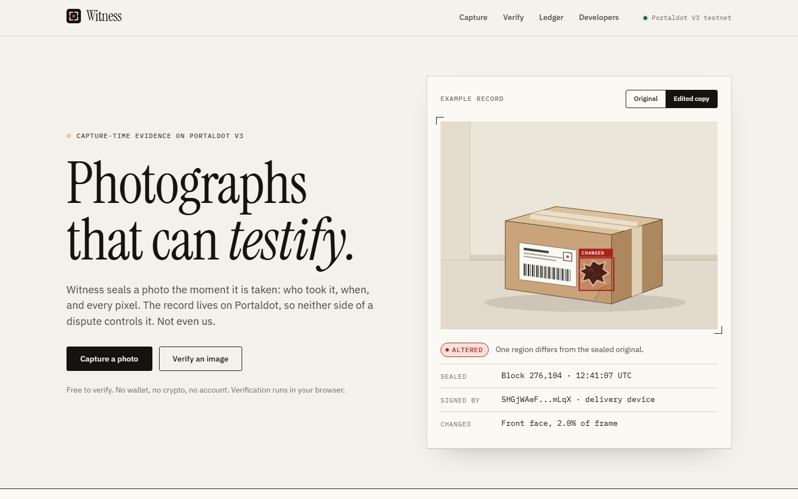
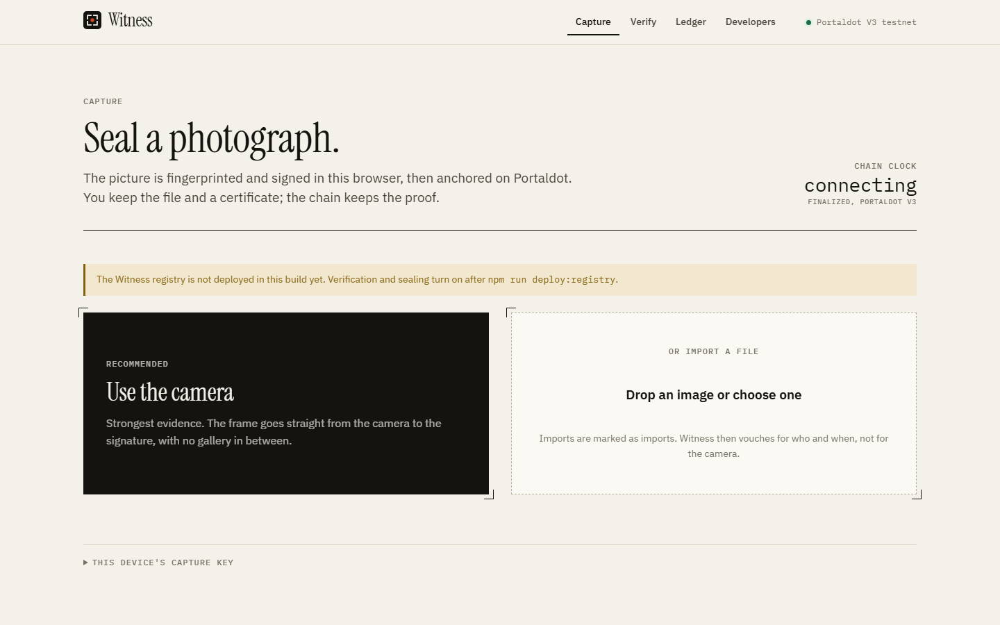
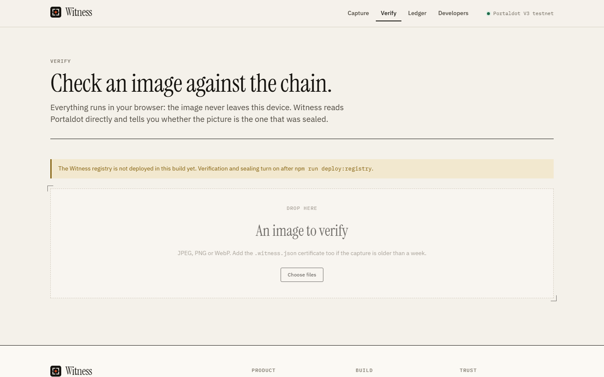
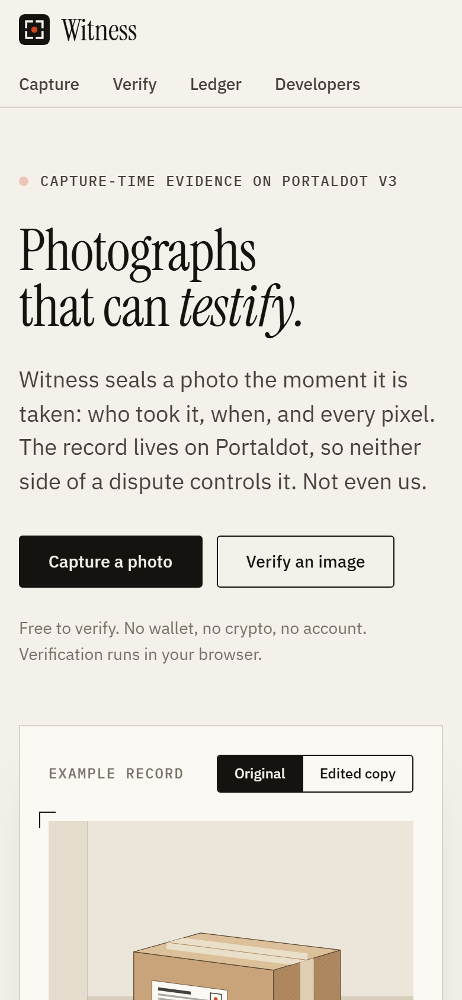

<div align="center">
  
  <h1>Witness</h1>
  <p><strong>Photographs that can testify.</strong><br />Capture-time evidence for photos, anchored on Portaldot V3.</p>

[](https://github.com/opeblow/witness/actions/workflows/ci.yml)
[](https://github.com/opeblow/witness/actions/workflows/contracts.yml)
[](https://github.com/opeblow/witness/actions/workflows/codeql.yml)
[](LICENSE)
[](https://node-console.portaldot.dev)
[](#testing)
[](.nvmrc)

</div>

Witness seals a photo the moment it is taken: who took it, when, and every pixel. The record lives on Portaldot, so neither side of a dispute controls it. Edit one region and verification says exactly where.

Built for **Portaldot Hacker House 2026**, Ecosystem DApps track.



## Table of contents

- [The problem](#the-problem)
- [How it works](#how-it-works)
- [Hackathon criteria and how Witness meets them](#hackathon-criteria-and-how-witness-meets-them)
  - [Judging criteria](#judging-criteria)
  - [Submission requirements](#submission-requirements)
- [Sponsor: how Portaldot V3 is used](#sponsor-how-portaldot-v3-is-used)
- [Screenshots](#screenshots)
- [File structure](#file-structure)
- [Quickstart](#quickstart)
- [Testing](#testing)
- [Limits](#limits)
- [Contributing and policies](#contributing-and-policies)
- [License](#license)

## The problem

Refund desks, couriers, rental companies and insurers settle disputes with photos, and photos are now trivial to fake. In Verisk's March 2026 survey, 99% of insurers had encountered manipulated or AI-altered claim documentation, and 36% of consumers said they would consider editing a claim photo. Detection tools are an arms race that every new model resets.

Witness flips the question from "is this fake?" to **"is this the photo that was taken?"**

## How it works

| Proof    | How                                                                                                               |
| -------- | ----------------------------------------------------------------------------------------------------------------- |
| **When** | The device embeds the latest finalized block before signing; anchoring bounds it from above. A window of seconds. |
| **Who**  | Every capture is signed with an Ed25519 device key, nameable through Portaldot Identity.                          |
| **What** | The exact SHA-256, plus a 3,072-byte colour fingerprint that survives re-compression and locates edits.           |

Each capture is **one atomic Portaldot extrinsic** that uses both runtimes:

```text
utility.batchAll([
  transactionStorage.store(signedEnvelope),            // native pallet: the evidence
  revive.call(WitnessRegistry, anchor(contentHash, …)) // Solidity: permanent, first-write-wins anchor
])
```

Any Solidity contract can then gate money on witnessed evidence. See [`ClaimGate.sol`](contracts/src/examples/ClaimGate.sol).

## Hackathon criteria and how Witness meets them

### Judging criteria

| Criterion                           | Weight | How Witness meets it                                                                                                                                                                                                                                                                                                                                                                                                                     |
| ----------------------------------- | -----: | ---------------------------------------------------------------------------------------------------------------------------------------------------------------------------------------------------------------------------------------------------------------------------------------------------------------------------------------------------------------------------------------------------------------------------------------- |
| **Technical implementation**        |    30% | A typed monorepo (core, SDK, notary, contracts, web app) with 67 TypeScript and 13 Solidity tests, lint, typecheck and CodeQL in CI. Each capture is one atomic extrinsic, so evidence and anchor can never be half-written. Design choices are recorded in five [ADRs](docs/adr), and attacks are covered in the [threat model](docs/threat-model.md).                                                                                  |
| **Innovation (use of V3 features)** |    30% | Uses both of Portaldot's runtimes in a single call: the native `transactionStorage` pallet holds the signed evidence, and a Solidity contract on `revive` holds the permanent anchor. Capture time comes from finalized blocks rather than the device clock. Instead of guessing whether a photo is fake, Witness proves which photo was taken and shows exactly which region changed. See [Sponsor](#sponsor-how-portaldot-v3-is-used). |
| **Ecosystem contribution**          |    20% | `@witness/sdk` lets any Portaldot app seal and verify photos, and `ClaimGate.sol` shows any contract releasing funds only on witnessed evidence. The notary pays fees, so users need no wallet or tokens. Open source under Apache 2.0, with a public [API](docs/api.md) and [manifest spec](docs/manifest-spec.md).                                                                                                                     |
| **Business value**                  |    20% | Targets condition evidence: returns, deliveries, rental deposits and insurance claims, where 99% of insurers have seen manipulated photos (Verisk, March 2026). Businesses pay per sealed capture through the notary ([ADR 0005](docs/adr/0005-sponsored-notary.md)). Go-to-market starts where one party controls capture, such as a courier app or a rental check-out ([ADR 0001](docs/adr/0001-provenance-over-detection.md)).        |

### Submission requirements

| Requirement                               | How Witness meets it                                                                                                                             | Status  |
| ----------------------------------------- | ------------------------------------------------------------------------------------------------------------------------------------------------ | ------- |
| Use Portaldot Network V3.0 core features  | `transactionStorage`, `revive`, `utility.batchAll`, `identity` and finality, detailed in the [sponsor table](#sponsor-how-portaldot-v3-is-used). | Done    |
| Deploy on the Portaldot testnet           | `npm run deploy:registry` deploys `WitnessRegistry`, and the address is written to [`deployments/`](deployments).                                | Pending |
| Code produced during the Hacker House     | Built between Oct 14 and Nov 6, 2026, with history spread across the event on GitHub.                                                            | Done    |
| Open source repository                    | This repository, Apache 2.0.                                                                                                                     | Done    |
| Demo video (3 minutes max) and pitch deck | Linked here once published.                                                                                                                      | Pending |

## Sponsor: how Portaldot V3 is used

The Hacker House is organized and sponsored by the **Portaldot Network Ecosystem Foundation**. Witness is built entirely on Portaldot V3, and every feature below runs on the V3 testnet (chain id `420420777`).

| Portaldot V3 feature               | How Witness uses it                                                                                                   | Code                                                                                         |
| ---------------------------------- | --------------------------------------------------------------------------------------------------------------------- | -------------------------------------------------------------------------------------------- |
| **`transactionStorage` pallet**    | Stores the signed capture envelope (manifest, signature and fingerprint) on chain, so the evidence itself is public.  | [`packages/sdk/src/substrate.ts`](packages/sdk/src/substrate.ts)                             |
| **`revive` (Solidity on PolkaVM)** | Runs `WitnessRegistry`, the first-write-wins anchor for each photo, and `ClaimGate`, which pays out only on evidence. | [`contracts/src`](contracts/src), [`packages/sdk/src/submit.ts`](packages/sdk/src/submit.ts) |
| **`utility.batchAll`**             | Wraps the storage write and the contract call into one atomic extrinsic, so both succeed or neither does.             | [`packages/sdk/src/substrate.ts`](packages/sdk/src/substrate.ts)                             |
| **Ethereum JSON-RPC endpoint**     | Reads anchors and `Anchored` events from the registry with standard EVM tooling (viem).                               | [`packages/sdk/src/registry.ts`](packages/sdk/src/registry.ts)                               |
| **Finalized blocks**               | The device embeds the latest finalized block in each capture, which proves the photo was not taken before that block. | [`apps/web/src/lib/use-chain-clock.ts`](apps/web/src/lib/use-chain-clock.ts)                 |
| **`identity` pallet**              | Shows a human-readable name for the device key that signed a capture, when one is registered.                         | [`packages/sdk/src/substrate.ts`](packages/sdk/src/substrate.ts)                             |
| **Sponsored fees**                 | The notary submits captures from its own funded account, so end users never hold tPOT.                                | [`services/notary`](services/notary)                                                         |

## Screenshots

| Verification locates the edit                                                                                                                         | Capture                                                                                                                              |
| ----------------------------------------------------------------------------------------------------------------------------------------------------- | ------------------------------------------------------------------------------------------------------------------------------------ |
|  The hero toggles between a sealed original and an edited copy, showing the changed cells. |  Camera-first capture with a live chain clock. Imports are labelled as weaker evidence. |
|  Verification runs in the browser; the image never leaves the device.                                      |  Responsive down to phone width.                                                               |

## File structure

```text
witness/
├── apps/
│   └── web/                         # React + Vite web app
│       ├── index.html
│       ├── public/                  # favicons, app icons, social image, web manifest
│       └── src/
│           ├── App.tsx              # routes
│           ├── main.tsx             # entry point
│           ├── components/
│           │   ├── Layout.tsx       # header, footer, page shell
│           │   ├── Logo.tsx
│           │   ├── ParcelScene.tsx  # landing page illustration
│           │   ├── VerdictView.tsx  # verification result
│           │   └── evidence.tsx     # evidence detail cards
│           ├── lib/
│           │   ├── chain.ts         # Portaldot connection
│           │   ├── config.ts
│           │   ├── device-key.ts    # device signing key
│           │   ├── format.ts
│           │   ├── image.ts
│           │   └── use-chain-clock.ts  # live finalized-block clock
│           ├── pages/
│           │   ├── Home.tsx         # landing page
│           │   ├── Capture.tsx      # take and seal a photo
│           │   ├── Verify.tsx       # check a photo against the chain
│           │   ├── Record.tsx       # one capture's evidence
│           │   ├── Ledger.tsx       # recent captures
│           │   └── Developers.tsx   # SDK and contract docs
│           └── styles/
│               └── global.css       # design tokens
├── contracts/                       # Solidity on Portaldot revive
│   ├── hardhat.config.ts
│   ├── src/
│   │   ├── WitnessRegistry.sol      # first-write-wins photo anchor
│   │   └── examples/
│   │       └── ClaimGate.sol        # releases funds only on witnessed evidence
│   └── test/                        # 13 Solidity tests
├── packages/
│   ├── core/                        # pure logic, no network
│   │   ├── src/
│   │   │   ├── bytes.ts
│   │   │   ├── canonical.ts         # stable JSON for hashing
│   │   │   ├── capture.ts           # build signed captures
│   │   │   ├── compare.ts           # locate edits
│   │   │   ├── fingerprint.ts       # colour fingerprint
│   │   │   ├── manifest.ts          # signed capture manifest
│   │   │   ├── raster.ts
│   │   │   ├── signing.ts           # Ed25519 signatures
│   │   │   ├── ss58.ts              # Portaldot addresses
│   │   │   └── verdict.ts           # authentic, altered, reframed, invalid, unverified
│   │   └── test/
│   └── sdk/                         # Portaldot access
│       ├── src/
│       │   ├── certificate.ts
│       │   ├── network.ts           # testnet endpoints
│       │   ├── notary-client.ts
│       │   ├── registry.ts          # WitnessRegistry client
│       │   ├── submit.ts
│       │   ├── substrate.ts         # batchAll(transactionStorage + revive)
│       │   └── verify.ts            # verifyImage
│       └── test/
├── services/
│   └── notary/                      # fee-paying relayer; cannot forge captures
│       ├── Dockerfile
│       ├── src/
│       │   ├── app.ts               # HTTP API
│       │   ├── chain.ts
│       │   ├── config.ts
│       │   ├── errors.ts
│       │   ├── main.ts
│       │   ├── rate-limit.ts
│       │   └── service.ts
│       └── test/
├── tools/
│   └── src/
│       ├── deploy-registry.ts       # deploy WitnessRegistry to testnet
│       ├── env.ts
│       ├── keys.ts                  # generate the sponsor key
│       ├── png.ts
│       ├── smoke.ts                 # end-to-end test on testnet
│       └── verify-live.ts           # audit a live deployment
├── deployments/                     # deployed contract addresses per network
├── docs/
│   ├── adr/                         # five architecture decision records
│   ├── brand/                       # logo and social card
│   ├── screenshots/
│   ├── api.md
│   ├── architecture.md
│   ├── deployment.md
│   ├── manifest-spec.md
│   └── threat-model.md
├── .github/                         # CI, contracts, CodeQL, Pages, live check
├── package.json                     # npm workspaces and scripts
├── tsconfig.base.json
├── vitest.config.ts
└── eslint.config.js
```

## Quickstart

```bash
npm install
npm test                  # 67 TypeScript tests
npm run test:contracts    # 13 Solidity tests
npm run dev               # web app on http://localhost:5173
```

Deploying to the testnet: see [docs/deployment.md](docs/deployment.md).

## Testing

- **Core:** synthetic scenes cover re-encoding, resizing, auto-enhance, pasted objects, edits of about 2% of the frame, colour-only edits, crops and unrelated pictures.
- **Notary:** every rejection path (bad signature, wrong network, stale or unknown block, duplicates, rate limits, chain failure) against a fake chain.
- **Contracts:** first-write-wins, single-slot storage layout, and every ClaimGate revert path.

## Limits

Witness proves provenance of pixels, not truth of the scene: a photographed screen is still a genuine photo of a screen. Imports are weaker than camera captures and are labelled so. Details are in the [threat model](docs/threat-model.md).

## Contributing and policies

[Contributing](CONTRIBUTING.md) · [Code of conduct](CODE_OF_CONDUCT.md) · [Security](SECURITY.md) · [Privacy](PRIVACY.md) · [Support](SUPPORT.md) · [Changelog](CHANGELOG.md)

## License

[Apache License 2.0](LICENSE)
