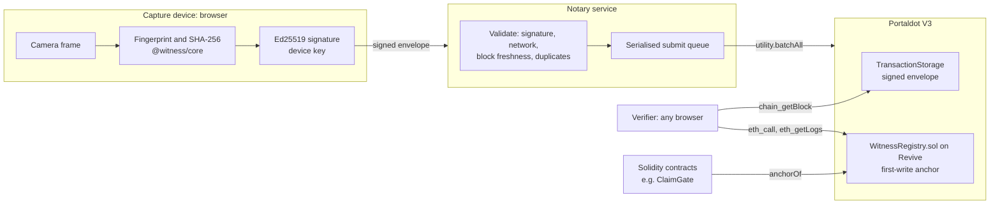

# Architecture

Witness proves that a photograph is the one that was taken, by whom and when. It does this by sealing evidence at capture time and anchoring it on Portaldot V3, so that any verifier, human or contract, can check an image without trusting Witness the company.

This document describes the system as built. Decisions and their alternatives are recorded in [adr/](adr).

## Goals

1. **Neutral.** No party to a dispute, including the operator, can alter or delete a record.
2. **Verifiable by anyone.** Verification needs only a browser and a public Portaldot node.
3. **Usable without crypto.** Capturers never hold tokens or a wallet.
4. **Composable.** Solidity contracts can make decisions on witnessed evidence.
5. **Private by default.** Proving a photo does not require publishing it.

## Non-goals

- Deciding whether a scene is real. Witness proves provenance of pixels, not truth of content. See [threat-model.md](threat-model.md).
- Detecting AI-generated images that were never sealed. Unsealed images return "no record", not "fake".

## Components



| Component          | Responsibility                                                                              | Trust                                                                                     |
| ------------------ | ------------------------------------------------------------------------------------------- | ----------------------------------------------------------------------------------------- |
| `@witness/core`    | Pure functions: canonical manifests, fingerprints, signatures, comparison, verdicts.        | None needed: deterministic and fully tested.                                              |
| `@witness/sdk`     | Talks to Portaldot: registry reads, envelope retrieval, capture extrinsic, verify pipeline. | Trusts the RPC node for availability, not for correctness: every envelope is re-verified. |
| Device key         | Signs manifests. Generated and kept in the browser.                                         | Holder of the key is "who".                                                               |
| Notary             | Validates and pays for submissions.                                                         | Can refuse or delay. Cannot forge, alter or backdate a capture.                           |
| `WitnessRegistry`  | Permanent anchor per content hash, first write wins.                                        | Code is the rule; no owner, no upgrade path.                                              |
| TransactionStorage | Stores the signed envelope in the anchoring block.                                          | Native Portaldot pallet.                                                                  |

## The capture flow

1. **Frame.** The camera frame is drawn to a canvas and encoded as JPEG. These exact bytes are the file the user keeps. `sha256(file)` is the capture id.
2. **Fingerprint.** The decoded pixels are converted to Y/Cb/Cr and resampled with exact area weighting to a 32 by 32 grid per channel (3,072 bytes), plus a 64-bit dHash. Resampling is done in `@witness/core`, never by canvas scaling, so all platforms produce identical numbers.
3. **Clock.** The device reads the latest finalized block number and hash. Embedding it proves the signature was made after that block.
4. **Sign.** The manifest is serialised canonically (sorted keys, integers only) and its SHA-256 is signed with Ed25519 under a domain tag (`witness/capture/v1`).
5. **Submit.** The envelope (`witness:v1\n` + canonical JSON) is posted to the notary.
6. **Validate.** The notary checks the signature, that the manifest names this network and genesis hash, that the referenced block exists with that hash and is at most 30 blocks old, and that the file is not already anchored.
7. **Anchor.** The notary submits one extrinsic:

   ```text
   utility.batchAll([
     transactionStorage.store(envelope),
     revive.call(WitnessRegistry, anchor(contentHash, manifestDigest, signer, dhash)),
   ])
   ```

   `batchAll` is atomic: if the registry call reverts (for example, the file was anchored concurrently), the stored envelope is rolled back too.

8. **Confirm.** The client waits until the registry reports the anchor through the EVM endpoint, then issues a certificate: the envelope plus its block.

## The verification flow

`verifyImage` in `@witness/sdk`:

1. Hash and fingerprint the suspect image locally.
2. `anchorOf(sha256)` on the registry. A hit means a bit-for-bit candidate.
3. Otherwise, read recent `Anchored` events and keep captures whose dHash is within 20 bits.
4. For each candidate, fetch the anchoring block over the Substrate RPC and find the `transactionStorage.store` call whose envelope describes that content hash, walking batch and proxy calls.
5. `evaluate` in `@witness/core` checks integrity (signature, anchor digest, signer, capture window) and compares fingerprints:
   - same SHA-256 and intact: **authentic, exact**;
   - no visible change: **authentic, visual** (re-encoded or resized);
   - localised changes: **altered**, with regions;
   - different aspect ratio but a matching crop window: **reframed**;
   - integrity failure: **invalid**, never authentic;
   - nothing related: **unverified**.

### Comparison algorithm

Per channel, both grids are normalised to zero mean and unit spread (with a floor so flat images do not amplify noise). The per-cell difference is the maximum over channels, chroma weighted at 0.75. The image-wide median is the noise floor; a cell changes when it exceeds `max(0.45, 3 * noise + 0.15)`. Changed cells are grouped into 8-connected regions; a region counts if it peaks above 1.0 and has two or more cells, or one cell above 1.5. A median above 0.6 means the pictures do not line up at all. When aspect ratios differ, a crop window is searched along the narrower axis at 1/256 resolution.

Tuning constants live in `COMPARE_TUNING` and are covered by synthetic tests for re-encoding, resizing, auto-enhance, pasted objects, small edits, recolouring, crops and unrelated scenes.

## Data model

### On chain: WitnessRegistry

```solidity
struct Anchor { address submitter; uint32 blockNumber; uint64 dhash; }   // one 32-byte slot
mapping(bytes32 contentHash => Anchor) private _anchors;
event Anchored(bytes32 indexed contentHash, bytes32 indexed signer, address indexed submitter,
               bytes32 manifestDigest, uint64 dhash, uint32 blockNumber);
```

Storage holds only what contracts need to make decisions. Everything else is in the event, which costs no storage deposit. See [adr/0003](adr/0003-registry-storage-layout.md).

### On chain: TransactionStorage

The envelope bytes, in the same extrinsic as the anchor. Typical size: 4.6 KB without a preview, up to about 70 KB with one.

### Off chain: certificate

```json
{
  "format": "witness.certificate",
  "version": 1,
  "network": "...",
  "registry": "0x...",
  "anchor": { "blockNumber": 0, "blockHash": "0x...", "extrinsicIndex": 0 },
  "capture": { "manifest": {}, "signature": "0x..." }
}
```

A certificate is a convenience copy. Its claims are always re-checked against the registry.

## Retention and permanence

| Data                           | Lifetime                                                                                                                                                               |
| ------------------------------ | ---------------------------------------------------------------------------------------------------------------------------------------------------------------------- |
| Registry anchor                | Permanent. Cannot be overwritten or deleted.                                                                                                                           |
| `Anchored` event               | Permanent in block history.                                                                                                                                            |
| Envelope in TransactionStorage | Retained for the pallet's retention period (100,800 blocks, about 7 days on testnet), renewable with `transactionStorage.renew`. Block bodies remain on archive nodes. |
| Certificate                    | As long as the user keeps it.                                                                                                                                          |

A capture stays verifiable as long as either the chain serves its block body or the user has the certificate, because the anchor's manifest digest proves the certificate is the original.

## Accounts across runtimes

The notary signs with an sr25519 account. When it calls `revive.call`, `msg.sender` inside the registry is that account's revive address, `keccak256(AccountId32)[12..32]`. This is the address contracts such as ClaimGate trust as a submitter. Device keys are Ed25519; their public keys are valid AccountId32 values and display as SS58 addresses, so Portaldot's Identity pallet can name them.

## Scaling

- **Reads** are client-side and hit public RPC endpoints. An indexer is only needed for similarity search beyond recent captures; the design adds one without changing the protocol.
- **Writes** are one extrinsic per capture today. The registry costs one storage slot per capture. Batched anchoring, one Merkle root per block of captures, reduces this to one slot per batch and is the planned enterprise path ([adr/0003](adr/0003-registry-storage-layout.md)).
- **Notary** instances are stateless apart from the in-memory rate limiter and nonce queue. Horizontal scaling uses one sponsor key per instance, or a shared limiter and nonce manager.

## Failure modes

| Failure                         | Behaviour                                                                                             |
| ------------------------------- | ----------------------------------------------------------------------------------------------------- |
| Registry call reverts           | Whole batch reverts; nothing is stored; client sees `submission_failed`.                              |
| Duplicate submission race       | Second batch reverts on `AlreadyAnchored`; the first wins.                                            |
| Stale or forged block reference | Rejected by the notary (`stale_block`, `unknown_block`) and by every verifier (capture window check). |
| Notary offline                  | Captures can be self-submitted with any funded account; the registry is permissionless.               |
| EVM endpoint lagging            | Client polls until the anchor is visible before issuing the certificate.                              |
| Envelope past retention         | Verifier falls back to the user's certificate.                                                        |
